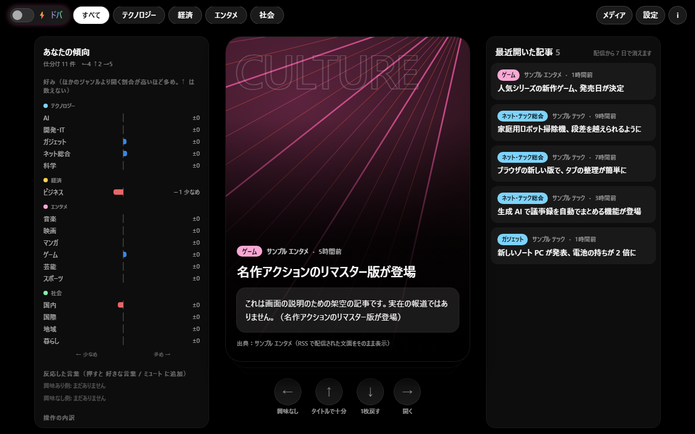
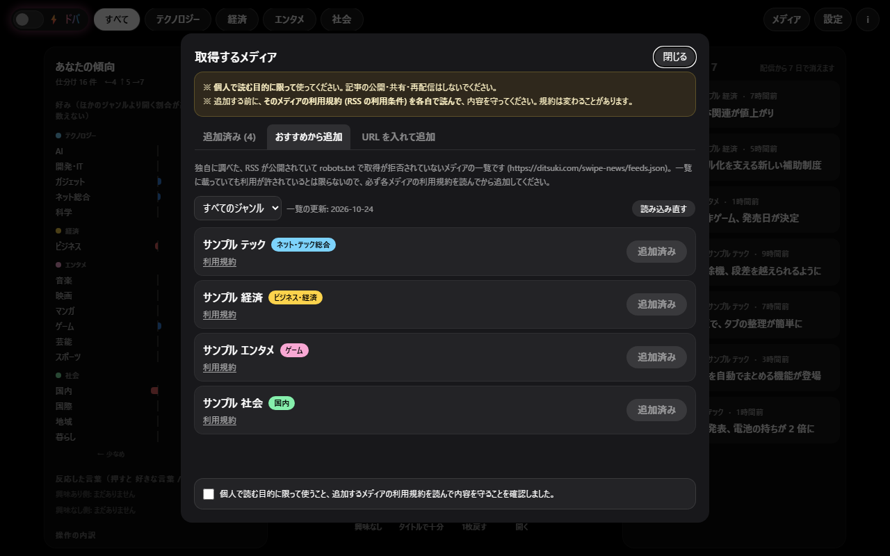

# Swipe News



RSS で集めたニュースを、カードをスワイプして仕分けながら読む、PC 用のニュースリーダーです。
「興味なし」「開く」「タイトルで十分」と仕分けていくと、好みを学んで、読みたい記事が前に来るように並び替わります。十字キーの操作のみで好みの登録、記事の閲覧、閲覧先ページから当アプリケーションに戻ることが可能であり、シンプルな操作を極めたUIです。加えて、昨今のSNSのように多くの情報が次から次へと流れていき、辞め時を失う作りになっています。
ジャンルの判定と好みの学習は、アプリケーションの中で動く小さなAIが行います。記事やデータを外部に送ることはありません。

時間内にどんどん仕分けていく「ドパモード」もあります。

**無料**で、すべての機能を使えます。

> **English:** A desktop news reader for your PC. Sort RSS headlines by swiping cards (← not interested, → open, ↑ the headline is enough),
> and it learns what you like and reorders the cards. A small AI that runs on your PC classifies genres and learns your preferences;
> nothing about what you read is sent anywhere. Add news sources yourself from a recommended list or by URL — for personal reading only,
> after reading each publisher's terms. Contributions are welcome: see [CONTRIBUTING.md](CONTRIBUTING.md).

> [!IMPORTANT]
> **個人で読む目的に限って使ってください。** 記事の公開・共有・再配信や、収益を得る目的での利用はしないでください。
> メディアを追加する前に、**そのメディアの利用規約（RSS の利用条件）を各自で読んで、内容を守ってください。**
> 多くのメディアは、RSS の利用を「個人利用のみ」「改変・再配信の禁止」としています。規約は変わることがあります。

## 特長

- **スワイプで仕分ける**: マウスでカードを左右上に払うか、ボタン・矢印キーで操作します
  - ← 興味なし / → 元の記事を開く / ↑ タイトルで十分（もう知っている記事など。学習には使いません）/ ↓ 1 枚戻す
- **好みを学んで並び替える**
  - 小ジャンル（AI・ゲーム・国内など 16 種類）ごとの好みと、「同じゲームでもこのシリーズは好き」のような話題ごとの好みを覚えます
  - 6 枚に 1 枚は、普段は後ろに回るジャンルから「たまにはこれも」を混ぜます
- **あなたの傾向**: 小ジャンルごとの好み・操作の内訳・直近 30 回の流れ・反応した言葉を、グラフでいつでも見られます
- **読むメディアは自分で選ぶ**: おすすめの一覧から選ぶか、RSS やサイトの URL を入れて追加します
- **ドパモード**: 演出が派手になり、カードは 5 秒で次へ。時間切れの前に仕分け続けるとコンボがつながります
- **元の文面のまま表示**: タイトルと概要は、メディアが RSS で配信したものを改変せずに出し、出典と元の記事へのリンクを必ず出します
- **PC の中だけで動く**: 画面はこの PC からだけ開けます。データもこの PC の中だけに保存します
- **配信元に配慮**: 各メディアの robots.txt を守り、同じサイトへは間をあけて取りに行きます。記事は配信から 7 日で消します

## インストール

GitHub で配布しています。

### Windows

1. [Releases](https://github.com/ItsukiYokoyama/swipe-news/releases/latest) から `SwipeNews-<バージョン>-windows.zip` をダウンロードする
2. zip を右クリック →「プロパティ」→「許可する」にチェックを入れてから、好きな場所に展開する
3. 展開してできたフォルダの `Swipe News.cmd` をダブルクリックする

ブラウザで画面が開き、タスクトレイにアイコンが出ます。初回に、スタートメニューへ「Swipe News」を登録します。
「許可する」にしないで展開したときは、最初の起動で「発行元を確認できませんでした」と出ます。「実行」を押せば、次からは出ません。
インストーラーは使わず、展開したフォルダがそのままアプリの場所です。アプリ・データの場所は、画面右上の **i** で見られます。
アンインストールも **i** の「アンインストールする」からできます（アプリのフォルダとスタートメニューの登録を消します。記録や設定も消すかは選べます）。
Python ごと同梱しているので、ほかに入れるものはありません（同梱しているのは python.org の公式の Python で、独自の exe は入っていません）。

### macOS / Linux

Python 3.11 以上が必要です。

```sh
pip install "swipe-news[desktop] @ git+https://github.com/ItsukiYokoyama/swipe-news"
swipe-news
```

ジャンル判定のモデル（約 44MB）は、初回の巡回のときに Hugging Face からダウンロードします。
Linux のタスクトレイは環境によって動かないので、そのときは `swipe-news --no-tray` で起動してください。

### 新しいバージョンへの更新

新しいバージョンが出ると、画面右上の **i** に「！」が出ます。「このアプリについて」のリンクからリリースノートを開き、次の手順で入れ替えてください。

1. 新しいバージョンの zip をダウンロードし、展開する
2. 今使っているフォルダを消して、新しいフォルダに置き換える（同じ場所に置けば、スタートメニューもそのまま使えます）
3. `Swipe News.cmd` から一度起動する

操作の記録・学習・設定・メディアの一覧は、アプリのフォルダとは別の場所（下の「プライバシー」）にあるので、そのまま引き継がれます。
古いバージョンのアプリは、タスクトレイのアイコンを右クリック →「終了」で止めてから置き換えてください。

## 使い方

1. 初めて起動すると「読むメディアを追加しましょう」と出るので、**メディア** を押す
2. 「おすすめから追加」で一覧から選ぶか、「URL を入れて追加」で RSS（またはサイトのページ）の URL を入れる
   - 追加するたびに、「個人で読む目的に限って使うこと、利用規約を読んで守ること」の確認にチェックを入れます
   - おすすめの一覧は「すべて追加」で、選んでいるジャンルのメディアをまとめて追加できます
   - 「記事の画像」（記事ページのプレビュー画像）は既定でオフです。規約を確かめてから、メディアごとに（または「すべてオン」で）オンにしてください
3. 記事が届いたら、カードを仕分けていく。新しい記事は 30 分おきに届きます



| 操作 | マウス・ボタン | キー |
|---|---|---|
| 興味なし | 左へ払う / ← ボタン | ← を 0.5 秒長押し |
| 元の記事を開く（学習では 2 票） | 右へ払う / → ボタン | → を 0.5 秒長押し |
| タイトルで十分（学習しない） | 上へ払う / ↑ ボタン | ↑ |
| 1 枚戻す | ↓ ボタン | ↓ |

- **ジャンルのチップ**（上部）: 大ジャンル・小ジャンルで絞り込みます
- **メディア**: 追加したメディアのジャンル・総合系かどうか・記事の画像・取得するかを変えたり、外したりできます
- **設定**: 表示しない小ジャンル、ミュートする言葉（含む記事を出さない）、好きな言葉（含む記事を前に出す）、新しいバージョンを確認するか
- **あなたの傾向**（左の列）: 「反応した言葉」を押すと、好きな言葉かミュートに追加できます
- **i**: このアプリについて（使うときのお願い・ライセンス）

### ドパモード


左上の **⚡ドパ** を押すと、ドパモードになります。

- 背景とカードの縁が虹色に光り、仕分けるたびに大きな文字・紙吹雪・画面の揺れ・効果音が出ます
- 一番手前のカードは **5 秒で自動的に「タイトルで十分」** になります（学習には使いません）。カードの縁が残り時間のゲージです
- 時間切れの前に仕分け続けるとコンボ。3 で GOOD、5 で GREAT!、10 で FEVER!!、20 で GODLIKE
- ← → の長押しは 0.25 秒になります
- カードを触っている間・設定などを開いている間・別のタブを見ている間は、カウントダウンが止まります
- 効果音は画面を開くたびにオフから始まります（🔇 を押すと鳴ります）

### Chrome 拡張機能「十字キーで戻る」（任意）

記事のタブで「← と → を押したまま ↑」（または ← と → を 0.7 秒長押し）すると、そのタブを閉じて Swipe News に戻ります。

1. Chrome で `chrome://extensions` を開き、右上の「デベロッパーモード」をオンにする
2. 「パッケージ化されていない拡張機能を読み込む」を押し、Swipe News のフォルダの中の `extension` フォルダを選ぶ

入れていないあいだは、画面の上に「🧩 拡張機能」が出ます。押すと、この手順と、`extension` フォルダをエクスプローラーで開くボタンが出ます。

拡張機能が見るのは矢印キーの押し方だけで、ページの中身は読みません。

## プライバシー

**読んだ記事・操作の記録・設定は、開発者を含め、どこにも送信しません。** すべてこの PC の中に保存します。

- 保存する場所: Windows は `%LOCALAPPDATA%\SwipeNews`、macOS は `~/Library/Application Support/SwipeNews`、
  Linux は `~/.local/share/swipe-news`
- 画面は、この PC（127.0.0.1）からだけ開けます。ほかの端末からは見られません
- 外部と通信するのは次のときだけです。どれも、ふつうに Web ページを開いたときと同じ情報（IP アドレスなど）しか相手に届きません
  - **追加したメディアの RSS を取るとき**（30 分おき）。各メディアの robots.txt を守り、同じサイトへは 2 秒以上あけて 1 本ずつ取ります
  - **「記事の画像」をオンにしたメディア**の、記事ページのプレビュー画像の場所を読むとき。画像は保存せず、表示のたびにブラウザが配信元から取ります
  - **「おすすめから追加」を開いたとき**、`https://ditsuki.com/swipe-news/feeds.json`（おすすめのメディアの公開の一覧）を読みます
  - **新しいバージョンの確認**（1 日 1 回まで）に、`https://ditsuki.com/swipe-news/latest.json`（最新のバージョン番号だけが書かれた公開ファイル）を読みます。「設定」でオフにすると、この確認もしません
  - **初めて巡回するとき**、ジャンル判定のモデルを Hugging Face からダウンロードします（Windows 版の zip には同梱しているので通信しません）
- ジャンルの判定と好みの学習は、PC の中で動く AI（ruri-v3-30m）が行います。記事の文面は判定にだけ使い、外部には送りません
- 記事は配信から 7 日で消します。操作の記録（日時・操作・ジャンル・媒体名など）は文章を持たないので残します

アンインストールは、アプリのフォルダとスタートメニューの「Swipe News」を消すだけです。データも消すなら、上の保存場所も消してください。

## 要望・お問い合わせ

「このメディアをおすすめに載せてほしい」などの要望は、[お問い合わせページ](https://ditsuki.com/contact?product=swipe-news)か、
[Issues](https://github.com/ItsukiYokoyama/swipe-news/issues) からお送りください。

---

## 開発者向け

Python（FastAPI）のサーバーと、ブラウザで開く画面（素の JavaScript）でできています。

```
swipe-news/
├── src/swipe_news/
│   ├── desktop.py      # 起動。サーバーを動かし、ブラウザを開き、タスクトレイにアイコンを出す
│   ├── server.py       # FastAPI。画面と API
│   ├── crawler.py      # 巡回。RSS を取って保存し、AI でジャンルの判定と好みの計算をする
│   ├── net.py          # 配信元へのアクセス（robots.txt の確認・同じサイトへの間隔）
│   ├── feeds.py        # メディアの設定（おすすめの一覧・手入力の URL の確認）
│   ├── db.py           # SQLite（並び順・操作の記録・学習の重み）
│   ├── genre_ai.py     # 内蔵 AI（ruri-v3-30m）でベクトルを作り、ジャンルを判定する
│   ├── taste.py        # 話題ごとの好みの学習と「反応した言葉」
│   ├── genres.yaml     # ジャンルの定義（AI が判定に使う説明文つき）
│   └── static/         # 画面（index.html / app.js / style.css / tailwind.css）
├── catalog/            # おすすめのメディアの一覧（ditsuki.com に置く元のファイル）
├── extension/          # Chrome 拡張機能「十字キーで戻る」
├── frontend/           # tailwind.css を作る設定
├── packaging/          # Windows 版の zip を作るスクリプト
├── tests/              # 自動テスト（pytest）
├── docs/               # しくみの説明と、README の画像
├── CONTRIBUTING.md     # 開発の手順
└── LICENSE             # GPL-3.0
```

```sh
uv venv --python 3.12 && uv pip install -e ".[desktop,dev]"
ruff check src tests && python -m pytest       # コードのチェックとテスト
python -m swipe_news --port 7871 --no-tray     # 起動
```

- 開発の手順（データのフォルダを分けて動かす・画面の CSS の作り直し・Windows 版の zip の作り方）は [CONTRIBUTING.md](CONTRIBUTING.md)
- 並び順と学習のしくみ・データベース・API は [docs/ARCHITECTURE.md](docs/ARCHITECTURE.md)
- おすすめのメディアの一覧の形式と載せる基準は [catalog/README.md](catalog/README.md)
- プルリクエストでは、GitHub Actions（`.github/workflows/ci.yml`）がコードのチェックとテストを Windows と Linux で動かします

### 同梱している Python と AI モデル

**Python（Windows 版の zip）**

- python.org の公式の埋め込み用 Python（embeddable package）**3.12.10（64 bit）** を、そのまま `python/` フォルダに入れています。独自の exe は作っていません
- ビルド（`packaging/build-portable.ps1`）では、zip のハッシュ（SHA-256）を固定して照合し、`python.exe` などに Python Software Foundation の署名があることも確かめます
- `python312._pth` で読み込む場所を zip の中だけに限っているので、PC に入っているほかの Python や `PYTHONPATH` の影響を受けません
- ライブラリ（FastAPI・uvicorn・feedparser・onnxruntime など）は `python/Lib/site-packages` に、あらかじめ .pyc にしたうえで同梱しています
- pip で入れる場合は、手元の Python 3.11 以上で動きます

**AI モデル**

- 使っているのは [ruri-v3-30m](https://huggingface.co/cl-nagoya/ruri-v3-30m)（名古屋大学の日本語の文章埋め込みモデル、約 3,000 万パラメーター、Apache License 2.0）です。
  文章を作るのではなく、文章の意味をベクトル（数の並び）に変えるための言語モデルです。記事の文面を書き換えたり、要約したりはしません
- 用途は 2 つだけです: **小ジャンルの判定**（記事のタイトルと概要のベクトルを、`genres.yaml` の説明文のベクトルと比べる）と、
  **好みの学習**（開いた記事・興味なしにした記事に近いかどうか）
- ONNX に変換して int8 に量子化したもの（[sirasagi62/ruri-v3-30m-ONNX](https://huggingface.co/sirasagi62/ruri-v3-30m-ONNX)、約 37MB + トークナイザー約 7MB）を、
  onnxruntime で **CPU だけで** 動かします。GPU は要りません。1 記事あたり 5 ミリ秒ほどです
- Windows 版は zip にモデルを同梱しています。pip で入れた場合は、初回の巡回のときに Hugging Face からダウンロードします。
  どちらも版（リビジョン）とファイルのハッシュを固定して照合しています（`genre_ai.py`）
- モデルは PC の中だけで動き、記事やデータを外部の AI サービスに送ることはありません。`SWIPE_NEWS_AI_GENRE=false` で止めることもできます（メディアに設定したジャンルをそのまま使います）

### 既知の制約

- PC で使うアプリです。スマホのブラウザでは動きを確かめていません（スワイプから新しいタブを開けないなど、挙動が安定しないため）
- AI のジャンル判定の精度は、総合系のメディアの記事で 74% ほどです（2026-10-20 に測定）。専門メディアの記事は、そのメディアのジャンルに引っ張られることがあります
- 「1 枚戻す」は、いま開いている画面で仕分けたカードだけです（読み込み直すと戻せません）
- 動作確認は Windows 11 と、ヘッドレスの Chrome での画面の操作まで。macOS・Linux では自動テストだけです

## コントリビュート / Contributing

不具合の修正・おすすめのメディアの追加・機能の改善など、プルリクエストを歓迎します。
手順は [CONTRIBUTING.md](CONTRIBUTING.md) を見てください。要望や不具合の報告は [Issues](https://github.com/ItsukiYokoyama/swipe-news/issues) へどうぞ。

## ライセンス / License

[GPL-3.0-or-later](LICENSE) — Copyright (C) 2026 Swipe News contributors

同梱・利用しているソフトウェアとモデルのライセンスは [THIRD_PARTY_NOTICES.md](THIRD_PARTY_NOTICES.md) にあります。
記事のタイトル・概要・画像の権利は、各メディアにあります。

---

# Swipe News (English)

A news reader for your PC that lets you sort RSS headlines by swiping cards.
As you sort them into "not interested", "open", and "the headline is enough", it learns what you like and moves the articles you want to read to the front.
Genre classification and preference learning are done by a small AI that runs on your PC. Nothing about what you read is sent anywhere.

There is also "Dopa mode", where you race against the clock to sort card after card.

It's **free**, and every feature is available to everyone.

> [!IMPORTANT]
> **Use it only for your own personal reading.** Don't publish, share, or redistribute articles, or use it to make money.
> Before adding a news source, **read that publisher's terms of use (RSS terms) yourself and follow them.**
> Many publishers allow their RSS feeds for personal use only and prohibit modification and redistribution. Terms can change.

## Features

- **Sort by swiping**: flick cards left, right, or up with the mouse, or use the buttons or arrow keys
  - ← not interested / → open the original article / ↑ the headline is enough (not used for learning) / ↓ undo one card
- **Learns and reorders**
  - Learns your preferences for each of 16 sub-genres (AI, games, domestic news, ...) and for specific topics ("I like this game series")
  - One card in six is "something different" from a genre that usually ends up at the back
- **Your trends**: see your preferences per sub-genre, a breakdown of your actions, your last 30 actions, and words you reacted to
- **You choose the sources**: add them from a recommended list or by entering an RSS or site URL
- **Dopa mode**: flashy effects, and each card moves on after 5 seconds. Keep sorting before time runs out to build a combo
- **Shown as published**: titles and summaries are shown exactly as each publisher's RSS feed provides them, always with the source and a link to the original
- **Runs only on your PC**: the screen can only be opened from your PC, and all data stays on your PC
- **Polite to publishers**: respects each site's robots.txt and spaces out requests to the same site. Articles are deleted 7 days after publication

## Installation

Swipe News is distributed on GitHub.

### Windows

1. Download `SwipeNews-<version>-windows.zip` from [Releases](https://github.com/ItsukiYokoyama/swipe-news/releases/latest)
2. Right-click the zip → "Properties" → check "Unblock", then extract it anywhere you like
3. Double-click `Swipe News.cmd` in the extracted folder

The screen opens in your browser and an icon appears in the system tray. On first launch, "Swipe News" is added to the Start menu.
If you extracted it without "Unblock", Windows says "The publisher could not be verified" on the first launch. Click "Run" and it won't appear again.
There's no installer: the extracted folder is the app. The **i** button in the top right shows where the app and its data are.
To uninstall, use "アンインストールする" (Uninstall) under **i**: it deletes the app folder and the Start menu entry, and optionally your history and settings.
Python is bundled, so you don't need to install anything else (it's the official Python from python.org; there are no custom executables).

### macOS / Linux

Requires Python 3.11 or later.

```sh
pip install "swipe-news[desktop] @ git+https://github.com/ItsukiYokoyama/swipe-news"
swipe-news
```

The genre classification model (about 44 MB) is downloaded from Hugging Face on the first crawl.
The system tray may not work in some Linux environments; if so, start it with `swipe-news --no-tray`.

### Updating to a new version

When a new version is released, a "!" appears on the **i** button in the top right. Open the release notes from the link in "About" and replace the app as follows.

1. Download and extract the zip of the new version
2. Delete the folder you're using now and replace it with the new folder (put it in the same place to keep the Start menu entry working)
3. Start it once from `Swipe News.cmd`

Your action history, learning, settings, and list of sources are stored separately from the app folder (see "Privacy" below), so they carry over.
Quit the old version first (right-click the tray icon → "終了" (Quit)) before replacing it.

## Usage

1. On first launch you'll see "読むメディアを追加しましょう" (Let's add sources to read). Click **メディア** (Sources)
2. Choose from the list under "おすすめから追加" (Add from recommendations), or enter an RSS (or site) URL under "URL を入れて追加" (Add by URL)
   - Each time you add a source, you check a box confirming that you'll use it only for personal reading and that you've read and will follow its terms
   - "すべて追加" (Add all) adds every recommended source in the selected genre at once
   - "記事の画像" (article images, the preview image of each article page) is off by default. Turn it on per source (or with "すべてオン", all on) after checking its terms
3. Once articles arrive, sort the cards. New articles arrive every 30 minutes

| Action | Mouse / buttons | Keys |
|---|---|---|
| Not interested | Flick left / ← button | Hold ← for 0.5 s |
| Open the original article (counts as 2 votes) | Flick right / → button | Hold → for 0.5 s |
| The headline is enough (not learned) | Flick up / ↑ button | ↑ |
| Undo one card | ↓ button | ↓ |

- **Genre chips** (top): filter by genre and sub-genre
- **メディア** (Sources): change each source's genre, whether it's a general-interest source, article images, or whether to fetch it; or remove it
- **設定** (Settings): sub-genres to hide, muted words (hide articles containing them), favorite words (move articles containing them forward), whether to check for new versions
- **あなたの傾向** (Your trends, left column): click a word you reacted to, to add it to your favorite or muted words
- **i**: about this app (requests for use, licenses)

### Dopa mode

Click **⚡ドパ** in the top left to turn on Dopa mode.

- The background and card edges glow in rainbow colors, and each sort triggers big words, confetti, screen shake, and sound effects
- The front card **automatically becomes "the headline is enough" after 5 seconds** (not used for learning). The card's border is the timer
- Keep sorting before time runs out to build a combo: GOOD at 3, GREAT! at 5, FEVER!! at 10, GODLIKE at 20
- Holding ← → takes only 0.25 seconds
- The countdown pauses while you're touching a card, while a dialog is open, or while you're on another tab
- Sound effects start muted every time the screen opens (click 🔇 to turn them on)

### Chrome extension "Back with arrow keys" (optional)

On an article's tab, hold ← and → and press ↑ (or hold ← and → for 0.7 seconds) to close the tab and return to Swipe News.

1. Open `chrome://extensions` in Chrome and turn on "Developer mode" in the top right
2. Click "Load unpacked" and choose the `extension` folder inside the Swipe News folder

Until it's installed, "🧩 拡張機能" (Extension) appears at the top of the screen. Click it for these steps and a button that opens the `extension` folder in Explorer.

The extension only watches how the arrow keys are pressed; it never reads the page's content.

## Privacy

**The articles you read, your action history, and your settings are never sent anywhere, including to the developer.** Everything is stored on your PC.

- Where it's stored: `%LOCALAPPDATA%\SwipeNews` on Windows, `~/Library/Application Support/SwipeNews` on macOS, `~/.local/share/swipe-news` on Linux
- The screen can only be opened from your PC (127.0.0.1); other devices can't see it
- It only talks to the outside world in these cases, and each one sends only the same information as an ordinary web page visit (such as your IP address)
  - **Fetching the RSS feeds of sources you added** (every 30 minutes), respecting each site's robots.txt, one request at a time with at least 2 seconds between requests to the same site
  - **For sources with "article images" on**, reading where each article page's preview image is. Images aren't saved; your browser loads them from the publisher each time they're shown
  - **When you open "Add from recommendations"**, it reads `https://ditsuki.com/swipe-news/feeds.json` (the public list of recommended sources)
  - **To check for new versions** (at most once a day), it reads `https://ditsuki.com/swipe-news/latest.json` (a public file containing only the latest version number). Turn this off in the settings to skip it
  - **On the first crawl**, it downloads the genre classification model from Hugging Face (the Windows zip bundles it, so no download is needed there)
- Genre classification and preference learning are done by an AI that runs on your PC (ruri-v3-30m). Article text is used only for classification and never sent anywhere
- Articles are deleted 7 days after publication. The action history (time, action, genre, source name, ...) contains no article text, so it's kept

To uninstall, delete the app folder and the "Swipe News" Start menu entry. To delete your data too, delete the folder listed above.

## Requests and contact

Send requests such as "please add this source to the recommendations" from the [contact page](https://ditsuki.com/en/contact?product=swipe-news)
or [Issues](https://github.com/ItsukiYokoyama/swipe-news/issues).

## For developers

A Python (FastAPI) server and a screen that opens in your browser (plain JavaScript). See the file tree in the Japanese section above.

```sh
uv venv --python 3.12 && uv pip install -e ".[desktop,dev]"
ruff check src tests && python -m pytest       # lint and tests
python -m swipe_news --port 7871 --no-tray     # run
```

- Development steps (running with a separate data folder, rebuilding the CSS, building the Windows zip): [CONTRIBUTING.md](CONTRIBUTING.md)
- How sorting and learning work, the database, and the API: [docs/ARCHITECTURE.md](docs/ARCHITECTURE.md)
- Format and criteria for the recommended source list: [catalog/README.md](catalog/README.md)
- On pull requests, GitHub Actions (`.github/workflows/ci.yml`) runs the lint and tests on Windows and Linux

The user interface and documentation are in Japanese.

### Bundled Python and AI model

**Python (Windows zip)**

- The official python.org embeddable package, **Python 3.12.10 (64-bit)**, is included as-is in the `python/` folder. There are no custom executables
- The build (`packaging/build-portable.ps1`) checks the zip against a pinned SHA-256 hash and verifies the Python Software Foundation signature on `python.exe` and friends
- `python312._pth` limits imports to the zip's own folders, so other Python installations and `PYTHONPATH` on the PC have no effect
- Libraries (FastAPI, uvicorn, feedparser, onnxruntime, ...) are bundled in `python/Lib/site-packages`, precompiled to .pyc
- A pip install runs on your own Python 3.11 or later

**AI model**

- The model is [ruri-v3-30m](https://huggingface.co/cl-nagoya/ruri-v3-30m), a Japanese sentence embedding model from Nagoya University (about 30M parameters, Apache License 2.0).
  It's a language model that turns the meaning of text into vectors; it doesn't generate text. It never rewrites or summarizes articles
- It's used for two things only: **sub-genre classification** (comparing the vector of an article's title and summary with the descriptions in `genres.yaml`)
  and **learning your preferences** (how close an article is to ones you opened or skipped)
- An ONNX int8 conversion ([sirasagi62/ruri-v3-30m-ONNX](https://huggingface.co/sirasagi62/ruri-v3-30m-ONNX), about 37 MB plus a 7 MB tokenizer)
  runs with onnxruntime **on the CPU only**. No GPU is needed; it takes about 5 ms per article
- The Windows zip bundles the model. A pip install downloads it from Hugging Face on the first crawl.
  Either way, the revision and file hashes are pinned and verified (`genre_ai.py`)
- The model runs only on your PC; articles and data are never sent to an external AI service. Set `SWIPE_NEWS_AI_GENRE=false` to turn it off (each source's configured genre is used as-is)

### Known limitations

- It's an app for PCs. Behavior in smartphone browsers hasn't been verified (they don't reliably allow opening a new tab from a swipe)
- Genre classification accuracy is about 74% for articles from general-interest sources (measured on 2026-10-20). Articles from specialist sources can be pulled toward that source's genre
- "Undo one card" works only for cards sorted in the screen you currently have open (it can't undo after a reload)
- Tested on Windows 11 and with screen interactions in headless Chrome. macOS and Linux are covered only by the automated tests

## Contributing

Pull requests for bug fixes, recommended sources, and improvements are welcome. See [CONTRIBUTING.md](CONTRIBUTING.md).
Send requests and bug reports to [Issues](https://github.com/ItsukiYokoyama/swipe-news/issues).

## License

[GPL-3.0-or-later](LICENSE) — Copyright (C) 2026 Swipe News contributors

Licenses of bundled and used software and models are listed in [THIRD_PARTY_NOTICES.md](THIRD_PARTY_NOTICES.md).
Article titles, summaries, and images belong to their publishers.
